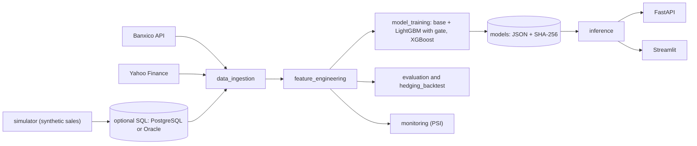

# FX cash-flow and hedging forecast (USD/MXN)

[](https://github.com/JyH-IA/fx-cashflow-hedging-forecast/actions/workflows/ci.yml)

> **Educational portfolio project.** The internal business data (sales, occupancy, cash-in) is synthetic, the company is fictional, and the hedging assumptions are illustrative. The exchange-rate and macro series can be real (Banxico, FRED) or synthetic (`make demo`); the dashboard says which. Nothing here is financial advice.

## Summary

A hospitality group that sells in USD but pays most of its costs in MXN (82 % in this scenario, a configurable assumption) is exposed to exchange-rate swings. This project forecasts the USD/MXN rate and the incoming USD cash flow at 30, 60 and 90 days, and simulates how forward contracts would have changed the monthly margin.

- **Models:** a hybrid that adds LightGBM, trained on out-of-sample residuals, to a base forecast (Prophet for cash-in, a random walk for the exchange rate). A validation gate keeps the LightGBM part only when it helps. The hybrid is compared with XGBoost, SARIMA, a random walk and a seasonal naive baseline.
- **Honest evaluation:** rolling-origin backtesting with MAPE, RMSE and MAE per horizon. The key figure is `rmse_vs_random_walk`: below 1 means the model beats a random walk. For exchange rates that is hard, and the reports say so when it happens.
- **Decision support:** covered-interest-parity forwards, a historical hedging simulation with a block bootstrap, a Streamlit dashboard for finance leaders and a FastAPI service.
- **Engineering:** typed Python (3.11 or 3.12) checked with `mypy --strict`, data contracts, tests with an 80 % coverage gate, CI (lint, types, tests, secret scan, dependency audit, Docker build) and SHA-256 integrity checks on the model files.

## Resumen en español

Proyecto educativo que pronostica el USD/MXN y el flujo de caja en USD a 30, 60 y 90 días para apoyar decisiones de cobertura con forwards. El tipo de cambio y las variables macro vienen de Banxico y FRED; los datos internos son sintéticos y la empresa es ficticia. Ningún modelo supera con claridad al *random walk* en el tipo de cambio. No es asesoría financiera.

## Data used

| Data | Source |
|---|---|
| USD/MXN (FIX rate) | Real: Banxico SIE API, with the Yahoo Finance close as a fallback |
| CETES 28 days, INPC | Real: Banxico SIE API (the INPC series ID, `SP1`, still needs checking) |
| Federal funds rate | Real: FRED CSV downloaded by hand |
| Cancun arrivals | Not used: the manual SECTUR file was not provided |
| Sales, occupancy, cash-in | Synthetic: seasonal simulator |
| Interest rates of the forward, bank spread and fee | Illustrative: `configs/business.yaml` |

## Dashboard

`make app` opens a dashboard with four tabs:

- **Summary:** a headline sentence, four key figures about what the selected hedge protects, and a bar chart of the possible MXN outcomes for each hedge level.
- **Hedging:** the hedge levels side by side and the USD/MXN forecast with its plausible range.
- **How reliable is it?:** the backtest comparison, read from `reports/metrics.json`.
- **Technical details:** how the forecasts are built, what the validation gate decided, a glossary and the assumptions.

A line under the title states the data source, the date of the last observation and the last USD/MXN rate; synthetic or unrecorded data shows as a warning. The USD/MXN line is flat because the base forecast is the last observed value, and the shaded band is the 95 % historical range of the move over the horizon. The layout was checked in a desktop browser only.

## Results and lessons

The figures come from a local `make evaluate-full` run on 2026-10-31 with five rolling origins, on the data above (USD/MXN from 2020-01-01 to 2026-10-30). Each value is the model's RMSE divided by the random walk's RMSE, so a value below 1 beats the random walk. They depend on the data in use: regenerate them with `make evaluate-full` and read `reports/backtest.md`.

| Target | Model | 30 days | 60 days | 90 days |
|---|---|---|---|---|
| Cash-in (`y_cash`) | Hybrid (Prophet base) | 0.603 | 0.443 | 0.386 |
| Cash-in (`y_cash`) | Seasonal naive (365 days) | 0.814 | 0.635 | 0.558 |
| Cash-in (`y_cash`) | XGBoost | 0.834 | 0.672 | 0.600 |
| Cash-in (`y_cash`) | SARIMA | 0.927 | 0.952 | 0.959 |
| USD/MXN (`y_fx`) | Seasonal naive (7 days) | 0.917 | 0.952 | 0.950 |
| USD/MXN (`y_fx`) | XGBoost | 0.955 | 0.987 | 0.952 |
| USD/MXN (`y_fx`) | SARIMA | 0.997 | 0.997 | 0.999 |
| USD/MXN (`y_fx`) | Hybrid (random-walk base) | 1.000 | 1.000 | 1.000 |

- **Cash-in.** The hybrid is the best model at every horizon, with 26 % to 31 % less error than the seasonal naive baseline. The validation gate rejected the residual tree, so the hybrid is Prophet alone. The internal data is synthetic and built with a seasonal pattern, so this shows that the method works when seasonality exists, not how a real business would perform.
- **Exchange rate.** No model clearly beats the random walk. The seasonal naive (7 days) is 5 % to 8 % better and XGBoost 1 % to 5 % better, but five origins are too few to tell gaps this small from chance, and a weekly pattern is not expected in an exchange rate. SARIMA ties the random walk. The hybrid matches it exactly (ratio 1.000 with identical errors), which means the gate rejected the residual tree and its forecast is the last observed value.
- **Real versus synthetic data.** On the synthetic series of `make demo` the exchange-rate hybrid trailed the random walk (1.56, 1.27 and 1.15) and the cash-in hybrid scored 0.49, 0.42 and 0.38. With real macro inputs and without `cancun_arrivals` the numbers above changed; the cause of each change was not isolated.

What the iterations taught (measured on the synthetic series of `make demo`, before the switch to real data):

- **A residual model can hurt.** In the diagnostic, the LightGBM correction made the exchange-rate forecast worse in 3 of 5 origins. A validation gate now keeps the tree only when it lowers the error on recent residuals.
- **Validate the way you will predict.** The first gate used the true exogenous values of each day, but forecasts hold them at their last known value. Scoring with the values frozen at the forecast origin removed that optimism.
- **Choose the base by evidence.** Prophet alone lost to a random walk at all five diagnostic origins for the exchange rate, so that target uses a random-walk base.
- **One validation window is a weak gate.** It uses a single window and a zero minimum improvement. It kept the exchange-rate tree in 2 of 5 folds and the hybrid still trailed the random walk. Only rejections are logged, so the validation errors of the kept trees are unknown.

## Quick start

```bash
make setup    # install the package with dev tools and pre-commit hooks
make demo     # synthetic data -> features -> models -> backtest -> hedging simulation
make app      # dashboard at http://127.0.0.1:8501
```

`make demo` needs no token and no network. The exchange-rate series it generates is an invented random walk, so its results only demonstrate that the pipeline runs; they say nothing about the real market. Training tunes LightGBM with Optuna and can take a few minutes; lower `optuna_trials` in `configs/training.yaml` to speed it up.

**Real data.** The pipeline can use real exchange-rate and macro series instead of the synthetic ones.

1. Request a token for the [Banxico SIE API](https://www.banxico.org.mx/SieAPIRest/service/v1/token), copy `.env.example` to `.env` and set `BANXICO_TOKEN`. `.env` is git-ignored: never commit it.
2. Comment out `DB_URL` in `.env` unless a PostgreSQL server is running (`make db-up`). With `DB_URL` set, `make ingest` also stores the simulated sales in that database and stops if it cannot connect.
3. Download the effective federal funds rate (series `DFF`) from FRED as a CSV and save it as `data/external/fed_funds.csv`. The SECTUR file `data/external/sectur_arribos.csv` (columns `month`, `cancun_arrivals`) is optional: without it, `cancun_arrivals` is left out.
4. Run the pipeline. `make ingest` stops at the end date of `configs/simulator.yaml`, so pass `--end` to bring the data up to date (it also extends the synthetic sales to that date):

```bash
python -m fxhedge.data_ingestion --end 2026-10-30
make features train evaluate-full hedge
make app
```

Notes:

- The series IDs in `configs/series.yaml` for the FIX rate (`SF43718`) and the 28-day CETES (`SF60633`) were checked against Banxico's documentation. `SP1` (INPC) still needs checking.
- Ingestion writes `data/raw/data_source.txt` (`banxico`), `make features` copies it to `data/processed/`, and the dashboard shows the source and the date of the last observation under the title.
- Do not run `make sample` after ingesting: it overwrites the raw files with synthetic data.
- `rate_mxn_pct` and `rate_usd_pct` in `configs/business.yaml` set the forward rate. They are illustrative and were set to 6.22 % and 3.88 % in October 2026; update them when you refresh the data.

**API and Docker.**

```bash
make api                                   # http://127.0.0.1:8000/docs
docker compose --profile app up --build    # dashboard and API in containers
```

## Architecture



The SQL layer is optional: without `DB_URL`, ingestion writes CSV files. More detail: [architecture](docs/architecture.md), [data contracts](docs/data_contracts.md), [finance formulas](docs/finance.md), [open questions](docs/open_questions.md) and the [executive summary](docs/cfo_one_pager.md).

## Repository layout

```text
src/fxhedge/   config, schemas, db, data_ingestion, data_source, simulator, sample_data,
               feature_engineering, model_training, evaluation, explain,
               finance, hedging_backtest, inference, monitoring, dashboard, api
app/           Streamlit dashboard
configs/       YAML configuration (business assumptions, series, training, monitoring)
sql/           versioned queries (PostgreSQL/SQLite and an Oracle schema)
notebooks/     EDA and baseline backtest (no stored outputs)
tests/         unit tests (no network, no secrets)
docs/          architecture, contracts, finance, open questions, executive summary
```

## Design decisions

- **No leakage.** Rolling statistics use the series shifted by one day, and the hybrid's residuals are generated out of sample with a time-series split that respects a gap.
- **Features known at forecast time.** Target lags are not known 30 to 90 days ahead, so the models use calendar features and exogenous variables carried forward from their last value. Scenarios shock those variables by plus or minus 10 %.
- **One base per target.** Cash-in has a real seasonal pattern, so its base is Prophet. For the exchange rate, Prophet lost to a random walk at every origin of the diagnostic, so its base is the last observed value (`BASE_BY_TARGET` in `model_training`).
- **Validation gate.** The residual tree is kept only if it lowers the error on the most recent residuals. It is scored with the exogenous variables frozen at the forecast origin, exactly as they are at inference time. If the gate rejects the tree, the hybrid is its base alone. `python -m fxhedge.model_training --no-gate` always keeps the tree.
- **Intervals are not VaR.** They come from the historical distribution of h-day log changes (a conservative proxy) unless backtest errors are supplied.
- **Safe artifacts.** No pickle. Prophet, the random-walk base and XGBoost are JSON, LightGBM uses its text format, and `metadata.json` stores SHA-256 hashes that are verified before loading. It also records the base, whether the residual tree is used and the gate's holdout errors.
- **Secrets.** Read from environment variables as `SecretStr`, sent in headers and never logged. See [SECURITY.md](SECURITY.md).

## Limitations and status

- **Checked in CI:** ruff, `mypy --strict`, the tests (coverage gate of 80 %), a secret scan and the Docker build. The dependency audit is advisory because new advisories can appear at any time.
- **Run end to end locally:** `make demo`, and with real data `make ingest`, `make features`, `make train`, `make evaluate-full` and `make app`.
- **Implemented but not run end to end:** `make api`, Docker Compose, drift monitoring (`make monitor`) and the PostgreSQL and Oracle schemas (SQLite is tested in CI).
- **Backtest size.** It has five origins and no confidence intervals, so gaps of a few percent against the random walk cannot be told from chance.
- **Target.** A MAPE below 2 % at 90 days is not used as a success criterion: exchange rates behave close to a random walk, so the honest benchmark is the random walk itself.
- **Scenarios.** When the gate rejects the tree for a target, its forecast comes from the base alone, and the scenarios (plus or minus 10 %) shock only the model features, so they do not move that forecast.
- **Gate.** It uses a single validation window (about three blocks of 90 days) and `gate_min_improvement` is 0 by default, so it can accept a tree that does not generalize.
- **Hedging simulation.** It assumes the next month's USD inflow is known when the hedge is placed, to isolate FX risk. It is a historical simulation, not an A/B test.
- **Not implemented:** MLflow tracking, a Java client example and a hashed `requirements.lock`. See [open questions](docs/open_questions.md) for the full list of items to verify.

## Roadmap

1. More backtest origins, with the error of each origin saved to give intervals or a significance test.
2. Walk-forward forecasts for the hedging simulation instead of the random-walk expectation.
3. Backtest-based prediction intervals and a proper VaR/CVaR module.
4. MLflow experiment tracking and a model registry.

## License

MIT, see [LICENSE](LICENSE).
