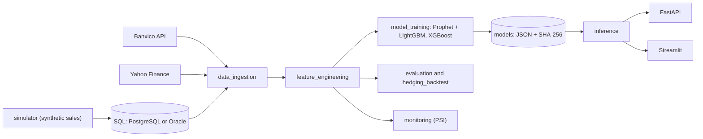

# FX cash-flow and hedging forecast (USD/MXN)

[](https://github.com/JyH-IA/fx-cashflow-hedging-forecast/actions/workflows/ci.yml)

> **Educational portfolio project.** The internal business data (sales, occupancy, cash-in) is synthetic, the company is fictional, and the figures are illustrative. Nothing here is financial advice.

## Summary

A hospitality group that sells in USD but pays most of its costs in MXN (82 % in this scenario, a configurable assumption) is exposed to exchange-rate swings. This project forecasts the USD/MXN rate and the incoming USD cash flow at 30, 60 and 90 days, and simulates how forward contracts would have changed the monthly margin.

- **Models:** Prophet for trend and seasonality plus LightGBM on its out-of-sample residuals, compared with XGBoost, SARIMA, a random walk and a seasonal naive baseline.
- **Honest evaluation:** rolling-origin backtesting with MAPE, RMSE and MAE per horizon. The key figure is `rmse_vs_random_walk`: below 1 means the model beats a random walk. For exchange rates that is hard, and the reports say so when it happens.
- **Decision support:** covered-interest-parity forwards, a historical hedging simulation with a block bootstrap, a Streamlit dashboard for finance leaders and a FastAPI service that another system (for example a Java/Spring Boot backend) can call.
- **Engineering:** typed Python 3.11, data contracts, SQL layer (PostgreSQL or Oracle), drift monitoring (PSI), model integrity checks, tests, CI and Docker.

## Resumen en español

Proyecto educativo que pronostica el tipo de cambio USD/MXN y el flujo de caja en USD a 30, 60 y 90 días para apoyar decisiones de cobertura con forwards. Los datos internos son sintéticos y la empresa es ficticia. Combina Prophet y LightGBM, los compara con *baselines* (incluido el *random walk*), simula históricamente la cobertura y expone los resultados en un panel de Streamlit y en una API. No es asesoría financiera.

## Quick start

```bash
make setup    # install the package with dev tools and pre-commit hooks
make demo     # synthetic data -> features -> models -> backtest -> hedging simulation
make app      # dashboard at http://127.0.0.1:8501
```

`make demo` needs no token and no network. The exchange-rate series it generates is an invented random walk, so its results only demonstrate that the pipeline runs; they say nothing about the real market. Training tunes LightGBM with Optuna and can take a few minutes; lower `optuna_trials` in `configs/training.yaml` to speed it up.

**Real data.** Copy `.env.example` to `.env`, set `BANXICO_TOKEN`, place the manual CSVs `data/external/sectur_arribos.csv` (columns `month`, `cancun_arrivals`) and `data/external/fed_funds.csv` (FRED format) and run `make ingest`. Verify the series IDs in `configs/series.yaml` first.

**API and Docker.**

```bash
make api                                   # http://127.0.0.1:8000/docs
docker compose --profile app up --build    # dashboard and API in containers
```

## Architecture



More detail: [architecture](docs/architecture.md), [data contracts](docs/data_contracts.md), [finance formulas](docs/finance.md) and the [one-page executive summary template](docs/cfo_one_pager.md).

## Repository layout

```text
src/fxhedge/   config, schemas, db, data_ingestion, simulator, sample_data,
               feature_engineering, model_training, evaluation, explain,
               finance, hedging_backtest, inference, monitoring, dashboard, api
app/           Streamlit dashboard
configs/       YAML configuration (business assumptions, series, training, monitoring)
sql/           versioned queries (PostgreSQL/SQLite and an Oracle schema)
notebooks/     EDA and baseline backtest (no stored outputs)
tests/         unit tests (no network, no secrets)
docs/          architecture, contracts, finance, open questions
```

## Design decisions

- **No leakage.** Rolling statistics use the series shifted by one day, and the hybrid's residuals are generated out of sample with a time-series split that respects a gap.
- **Features known at forecast time.** Target lags are not known 30 to 90 days ahead, so the models use calendar features and exogenous variables carried forward from their last value. Scenarios shock those variables by plus or minus 10 %.
- **Intervals are not VaR.** They come from the historical distribution of h-day log changes (a conservative proxy) unless backtest errors are supplied.
- **Safe artifacts.** No pickle. Prophet and XGBoost are JSON, LightGBM uses its text format, and `metadata.json` stores SHA-256 hashes that are verified before loading.
- **Secrets.** Read from environment variables as `SecretStr`, sent in headers and never logged. See [SECURITY.md](SECURITY.md).

## Limitations and status

- CI runs ruff, `mypy --strict`, the tests (at least 80 % coverage), a secret scan and the Docker build. The dependency audit is advisory because new advisories can appear at any time.
- A target of MAPE below 2 % at 90 days is not used as a success criterion: exchange rates behave close to a random walk, so the honest benchmark is the random walk itself.
- The hedging simulation assumes the next month's USD inflow is known when the hedge is placed, to isolate FX risk. It is a historical simulation, not an A/B test.
- MLflow tracking, a Java client example and a hashed `requirements.lock` are not implemented. See [open questions](docs/open_questions.md) for the full list of items to verify.

## Roadmap

1. Walk-forward forecasts for the hedging simulation instead of the random-walk expectation.
2. Backtest-based prediction intervals and a proper VaR/CVaR module.
3. MLflow experiment tracking and a model registry.
4. A Spring Boot client generated from the OpenAPI contract (`make openapi`).
5. A second project on member retention (survival analysis, classification and uplift).

## License

MIT, see [LICENSE](LICENSE).
